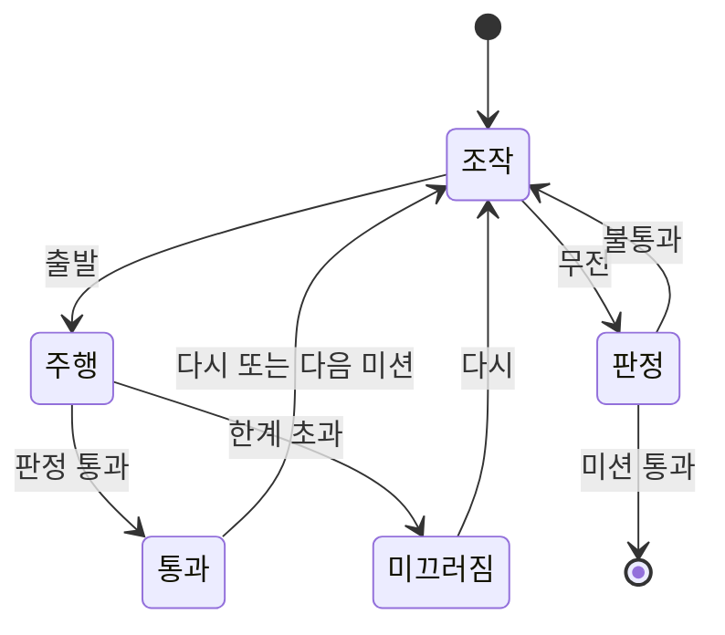

# Data Model: 레이스 엔지니어

## 값 객체

### CornerSetup

| 필드 | 타입 | 규칙 |
|---|---|---|
| radius | number (m) | > 0 |
| surface | `'dry' \| 'wet'` | μ로 변환 |
| wing | `'none' \| 'mid' \| 'high'` | k로 변환 |

### GripLimit (판별 유니언)

```ts
type GripLimit =
  | { kind: 'finite'; speed: number }        // m/s, 최고 속도 이하
  | { kind: 'aboveTopSpeed'; speed: number } // m/s, 화면에 숫자를 보이지 않음
  | { kind: 'none' };                        // m − μkr ≤ 0
```

불변식: `m − μkr ≤ 0`을 먼저 검사한다. `none`일 때 속도를 계산하지 않는다. k = 0이면 항상 `finite` 또는 `aboveTopSpeed`.

## 판정

```ts
type RadioAnswer = { kind: 'number'; value: number } | { kind: 'noLimit' };
type Verdict = { ok: boolean; reason: 'pass' | 'slid' | 'tooSlow' | 'tooHigh' | 'tooLow' | 'wantedNoLimit' | 'invalid' };
```

- 숫자 판정은 입력 원값을 그대로 비교한다
- 빈 값·숫자 아님·0 이하는 `invalid`이고 시도로 치지 않는다

## 미션

| 미션 | 입력 | 판정 |
|---|---|---|
| M1 | 슬라이더 속도 | 한계 − 5 ≤ v ≤ 한계 |
| M2, M5 | 비율 + 선택지 | 정답 ±0.02 + 선택지 일치 |
| M3 | km/h | ±2 |
| M4 | km/h | ±3 |
| M6 | m | ±2 |
| M7 | 코너별 km/h 또는 noLimit | 0.97 × 한계 ≤ v ≤ 한계 + 0.01, 코너 4 필수, 4/5 이상 |
| M8 | m/s² | ±1 |

## 상태 전이



## 저장

키 `race-engineer:*`: 끝낸 미션 목록, M7 코너별 결과. 값이 없거나 깨져 있으면 처음 상태로 시작한다.
